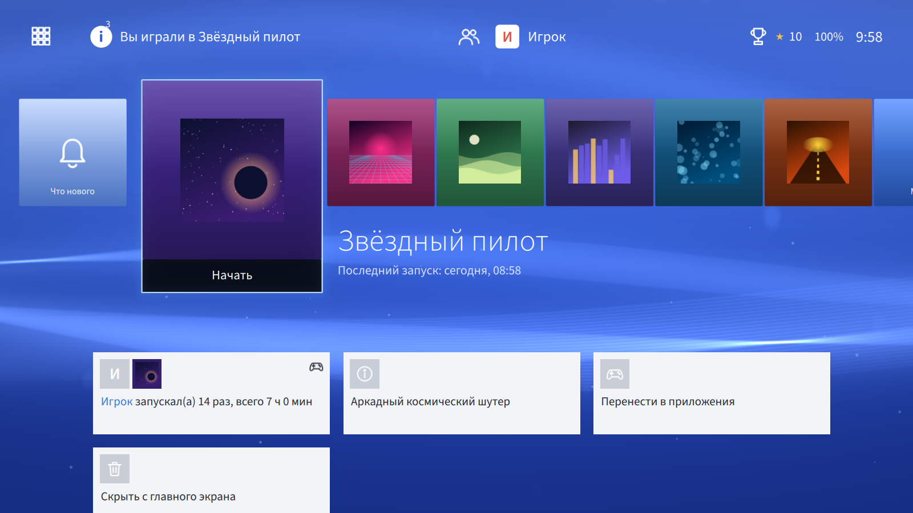
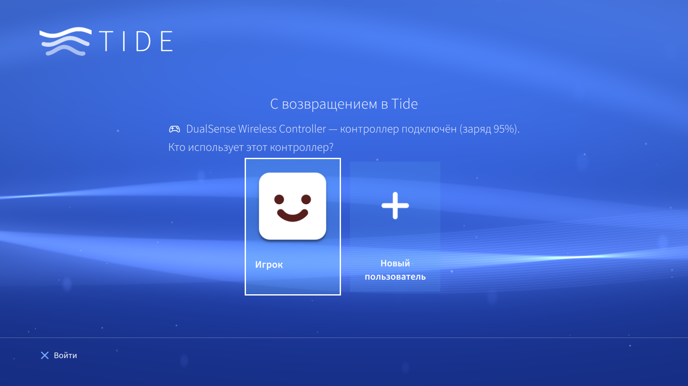
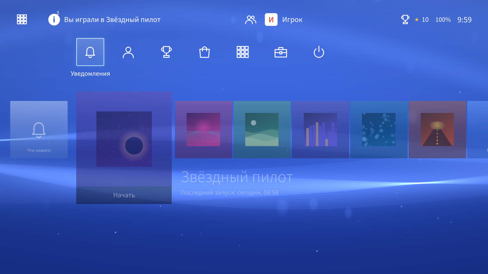
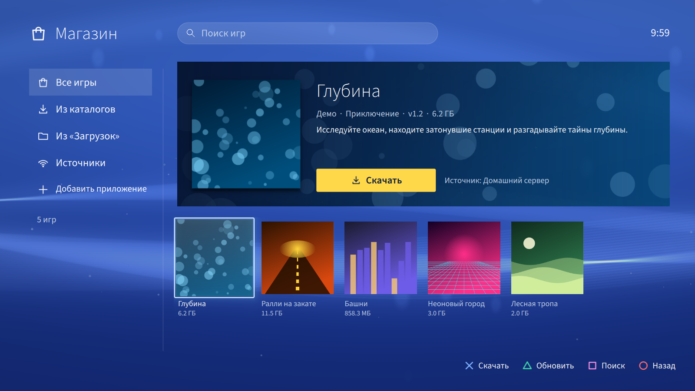
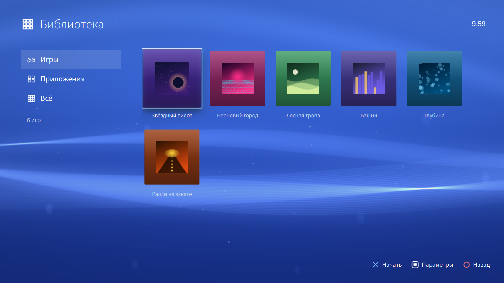
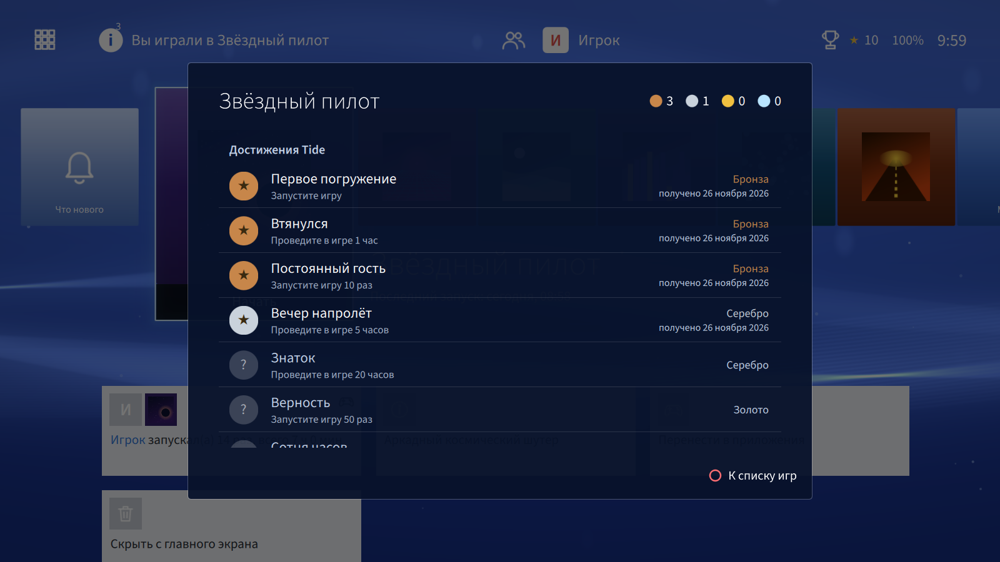

# 🌊 Tide

**Полноэкранный лаунчер игр и приложений для Linux в стиле игровой консоли.**
Включил ПК, взял геймпад, выбрал игру: без рабочего стола, мыши и окон.

*A fullscreen, gamepad-first game & app launcher for Linux with a console-style UI (PySide6 + QML). Interface language: Russian.*



<table>
  <tr>
    <td><br><sub>Выбор пользователя</sub></td>
    <td><br><sub>Верхний ряд функций</sub></td>
  </tr>
  <tr>
    <td><br><sub>Магазин</sub></td>
    <td><br><sub>Библиотека</sub></td>
  </tr>
  <tr>
    <td colspan="2" align="center"><br><sub>Достижения игры</sub></td>
  </tr>
</table>

<sub>На скриншотах демо-игры с придуманными названиями и обложками.</sub>

---

## ✨ Возможности

### 🎮 Как на консоли
- **Заставка при запуске** и экран **«Кто использует этот контроллер?»** с выбором пользователя и мелодией.
- **Главная лента** с крупными плитками игр, карточками «Что нового» и верхним рядом быстрых функций: уведомления, профиль, достижения, магазин, библиотека, настройки, питание.
- **Живой фон с волнами** на шейдере и несколько цветовых тем.
- **Быстрое меню** по кнопке PS: громкость, устройство вывода, питание.
- Управление **полностью с геймпада** или клавиатуры, мышь не нужна.

### 🕹️ Игры
- Библиотека собирается сама: игры из ярлыков `.desktop` (Steam, Lutris и т. п.) и **игры PS4 для эмулятора [shadPS4](https://github.com/shadps4-emu/shadPS4)**. Для них показываются название, иконка и фон из `param.sfo`.
- Запуск игр PS4 в эмуляторе в один клик: на весь экран, по желанию со счётчиком FPS.
- Учёт времени в игре и числа запусков.
- **Добавить приложение с ПК**: любую установленную программу или файл (AppImage, скрипт) можно вынести на главный экран. Системные утилиты в ленту не попадают.

### 🏆 Достижения
- У **каждой игры** есть свои достижения: бронза, серебро, золото и платина за запуски и время в игре.
- **Трофеи PS4**: если shadPS4 ведёт учёт трофеев, лаунчер показывает их с иконками, датами и скрытыми трофеями.
- Уведомление о новом достижении, когда закрываешь игру.

### 🛒 Магазин
- **Каталоги** в JSON по ссылке или с диска: свой сервер, NAS с резервными копиями и т. п. Поддерживаются два формата (см. ниже).
- **Ссылки проверяются в фоне**: в магазине видны только игры, у которых файл действительно скачивается. Мёртвые зеркала отбрасываются, нужное зеркало выбирается само.
- **Обложки и фон** подбираются по названию игры, показывается **размер** файла.
- **Поиск** по названию, Title ID, издателю и жанру.
- **Установка в один клик**:
  - архивы `.zip`, `.7z`, `.rar`, `.tar`, в том числе многотомные (`.part1.rar`, `.001`);
  - пакеты **PS4 `.pkg`**, через внешний распаковщик;
  - всё, что лежит в «Загрузках» и «Документы/Games», находится автоматически.

### 🎛️ Геймпады
- **DualSense (PS5)**, DualSense Edge, **DualShock 4**, Xbox и виртуальный геймпад Steam.
- Несколько геймпадов одновременно, подключение на ходу, показ заряда DualSense и DualShock 4.

### 🎨 Своё оформление
- Свои звуки интерфейса и мелодия экрана выбора пользователя: достаточно положить файлы в папку (см. ниже).
- Своя иконка приложения.

---

## 📦 Установка

### Зависимости

| Что | Зачем | Arch / CachyOS |
|---|---|---|
| Python 3.10+ | сам лаунчер | `python` |
| PySide6 (Qt 6 с QtQuick и QtMultimedia) | интерфейс, звук | `pyside6` |
| bsdtar (libarchive) | распаковка архивов | `libarchive` |
| ffmpeg | свои звуки (mp3 → wav) | `ffmpeg` |
| unrar *(необязательно)* | многотомные RAR | `unrar` |
| [shadPS4](https://github.com/shadps4-emu/shadPS4) *(необязательно)* | игры PS4 | AppImage |
| консольный распаковщик PKG *(необязательно)* | установка `.pkg` | например, ShadPs4Plus PKG Extractor |

```bash
sudo pacman -S python pyside6 libarchive ffmpeg unrar
```

### Запуск

```bash
git clone https://github.com/<ваш-аккаунт>/TideLauncher.git
cd TideLauncher
python main.py                # на весь экран
python main.py --windowed     # в окне
python main.py --skip-intro   # сразу на главный экран
```

Запуск вместе с системой включается в «Настройки › Система».

---

## ⌨️ Управление

| Действие | Геймпад (PlayStation) | Клавиатура |
|---|---|---|
| Перемещение | крестовина / левый стик | стрелки |
| Выбрать | ✕ | Enter, Пробел |
| Назад | ○ | Esc, Backspace |
| Действие из подсказки | △ | T, Delete |
| Поиск | □ | F, S, `/` |
| Параметры | Options | O, Tab, F2 |
| Быстрое меню / домой | PS | Home, F1, Q |
| Вкладки | L1 / R1 | Page Up / Page Down |
| Полный экран | — | F11 |

---

## 🗂️ Каталоги магазина

Каталог добавляется в «Магазин › Источники» ссылкой (`https://…`) или путём к файлу.

**Формат Tide**: прямые ссылки, пути можно указывать относительно файла каталога:

```json
{
  "name": "Мой сервер",
  "games": [
    {
      "title": "Моя игра",
      "titleId": "CUSA00000",
      "url": "games/my-game.zip",
      "icon": "icons/my-game.png",
      "background": "bg/my-game.jpg",
      "size": 123456789,
      "description": "Описание",
      "sha256": "…"
    }
  ]
}
```

**Формат списка ссылок на файлообменники**: несколько зеркал, несколько частей у каждого:

```json
[
  {
    "name": "Моя игра",
    "page_url": "https://example.com/my-game",
    "download_links": {
      "mediafire": ["https://www.mediafire.com/file/…/part1.rar/file", "…part2…"],
      "1file": ["…", "…"],
      "other": []
    },
    "total_links": 4
  }
]
```

Зеркала перебираются по порядку: MediaFire, 1File, остальные. Несколько ссылок одного зеркала считаются частями одного архива.

---

## 🔧 Настройка своими файлами

Всё хранится в `~/.config/tide-launcher/`:

| Файл | Что делает |
|---|---|
| `state.json` | пользователи, настройки, статистика |
| `media/startup.mp3` | мелодия на экране выбора пользователя |
| `media/select.mp3` | звук нажатия кнопки |
| `media/scroll.mp3` | звук перемещения по меню |
| `media/login.mp3` | звук после выбора пользователя |
| `media/app-icon.png` | иконка приложения |
| `media/logos/*.png` | свои логотипы (ключи `logo_*` в `state.json`) |

Подходят mp3, ogg, wav, flac и m4a. Если файла нет, звука нет. Кэш (обложки, проверенные ссылки, звуки) лежит в `~/.cache/tide-launcher/`.

**Трофеи PS4** shadPS4 записывает, только если в его `keys.json` задан ключ трофеев. Ключ в проект не входит.

---

## 🏗️ Как устроено

```
main.py        — бэкенд на Python: поиск игр, запуск, магазин, проверка ссылок,
                 установка, достижения, геймпады, системные функции
Main.qml       — весь интерфейс на QML
shaders/       — шейдер живого фона с волнами
fonts/         — Source Sans 3 (SIL Open Font License)
```

---

## ⚖️ Правовое

- Используйте магазин и установку только для игр, которыми вы владеете законно: своих копий и резервных копий. Проект не содержит и не распространяет игры, ключи или прошивки.
- Проект не связан с Sony Interactive Entertainment. «PlayStation», «PS4», «PS5», «DualShock» и «DualSense» — товарные знаки их владельцев и упоминаются только для описания совместимости.
- Код распространяется по лицензии [MIT](LICENSE). Шрифт Source Sans 3 распространяется по лицензии SIL Open Font License, см. [`fonts/LICENSE.md`](fonts/LICENSE.md).
